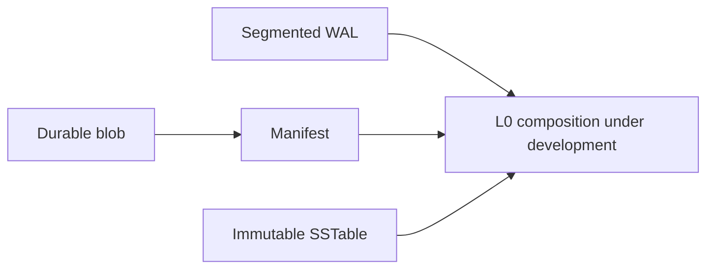

# Alvoki

Alvoki is an experimental Lean 4 project for specifying and checking storage components. The current work is component focused: a segmented WAL, durable blob publication, a small manifest, and immutable SSTable building and lookup. These components have separate contracts, models, proofs, and selected Linux fixtures. They do not yet form a supported database API.



The work intentionally keeps component guarantees and their premises visible. Lean proofs establish model properties; native fixtures exercise selected Linux behavior; native refinement remains an explicit boundary. In particular, successful file and directory syncs, exact reads, descriptor lifetime, stable directory ownership, and crash selection rely on filesystem primitives and assumptions documented with the relevant component. See [proof design](docs/proof-architecture.md), [WAL recovery notes](docs/design/wal-recovery.md), and [current progress](docs/progress.md).

## Build and verify

Install the pinned Lean toolchain, then run the reproducibility checks from the repository root:

```sh
bash scripts/bootstrap.sh
bash scripts/reproduce.sh
```

The checks cover retained component proofs, native fixtures and Markdown links. The active SSTable integration adds its own checks when present.

## Source map

- [Component experiments](lean/Alvoki/Experiments/README.md)
- [WAL contract, model and proof notes](lean/Alvoki/Experiments/WAL/README.md)
- [Durable blob contract](lean/Alvoki/Experiments/DurableBlob/README.md)
- [Manifest contract](lean/Alvoki/Experiments/Manifest/README.md)
- [Immutable SSTable](lean/Alvoki/Experiments/SSTable/README.md)
- [Shared codec primitives](lean/Alvoki/Codec/Block.lean) and [proof contracts](lean/Alvoki/Kernel/BlockContracts.lean)
- [Native Linux bindings](lean/native/README.md)

## License

Alvoki is licensed under the Apache License, Version 2.0. See [LICENSE](LICENSE).
