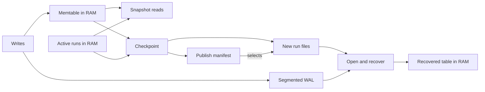

# Alvoki

Alvoki is an experimental embedded LSM-style key-value storage engine written in Lean 4. The project explores how to build a fast native engine whose storage guarantees can be checked by Lean. The central goal is that after a crash, reopening the database returns the right table from the files that survived, with every acknowledged write accounted for.

## What you can use today

The Linux `DiskTable` API stores unsigned 64-bit keys and values. It supports puts and deletes, point lookups, ordered range reads, and snapshots of retained history. It uses a segmented write-ahead log for durability and immutable sorted runs for checkpoints. Active run bytes and the memtable reside in RAM; checkpointing, WAL rotation, compaction, and collection are explicit maintenance operations.



Alvoki is pre-release. The current API is sequential, expects a dedicated directory controlled by the engine, and is tested on Linux x86-64. On-disk formats may change during development.

## What Lean checks

Lean checks the executable encoding, replay, and snapshot operations against logical models. Across the crash and recovery sequences covered by the proofs, every acknowledged write remains in order. A write whose outcome was uncertain can survive if the durable marker selects it, and supported snapshots agree with abstract replay.

The recovery proofs use explicit assumptions about the filesystem, file identities, and the effects of native calls. Native fault tests exercise selected outcomes at the adapter boundary. The remaining end-to-end work connects the native execution continuously across all supported recovery paths. [Verification status](docs/verification-status.md#storage-engine-guarantees) · [Proof roadmap](docs/proof-roadmap.md)

## Use the API

This Lean program opens an existing dedicated directory, writes a value and reads
it through a snapshot. Pass the directory as its only argument.

```lean
import Alvoki.Storage.Disk.DiskTable
open Alvoki.Storage

def main (args : List String) : IO Unit := do
  let [path] := args | throw (IO.userError "expected database directory")
  let db ← DiskTable.open path
  try
    let _ ← db.write 7 (some 42)
    let snapshot ← db.acquire
    try
      IO.println s!"{← db.lookup snapshot.handle 7}"
    finally
      db.release snapshot.handle
  finally
    db.close
```

For a runnable Lake project and an example that closes and reopens the database,
see [getting started](docs/getting-started.md#write-close-and-reopen-a-database).

## Reproduce on Linux x86-64

From the repository root, install the pinned toolchains and run the storage checks. You'll need Bash, curl, tar, unzip, sha256sum, Python 3, and a C compiler available as `cc`.

```sh
bash scripts/bootstrap.sh
bash scripts/check-sequential.sh
```

The getting-started guide shows how to write a value, close the database, reopen it, and read the value in a Lean program. It also covers the packed storage checks, native fault fixtures, and reproducible benchmarks. [Getting started](docs/getting-started.md)

## Explore the project

- See how `DiskTable` writes, checkpoints, and recovers data. [Architecture](docs/architecture.md#sequential-storage)
- Follow the correctness argument and the remaining engine work. [Proof architecture](docs/proof-architecture.md) · [Proof roadmap](docs/proof-roadmap.md) · [Engine roadmap](docs/roadmap.md)
- Explore the Lean and Rust performance experiments and the separately verified Verus search core. [Benchmarks](docs/performance/benchmarks.md) · [Documentation index](docs/README.md)

## License

Alvoki is licensed under the Apache License, Version 2.0. [License text](LICENSE)
