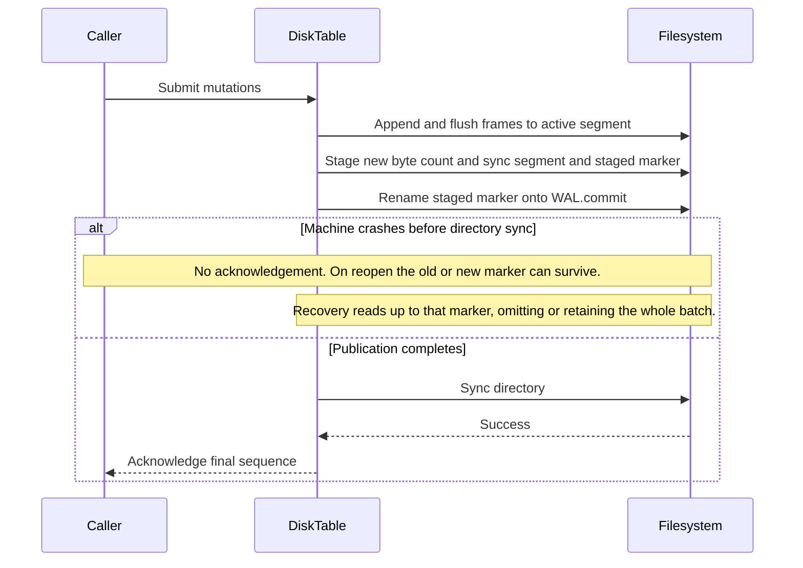

# Alvoki architecture

Alvoki is a sequential embedded key-value store. The Linux `DiskTable` adapter manages the lock, write-ahead log and checkpoint files. Its in-memory `PackedTable` serves snapshots over a memtable and immutable sorted runs. The logical table and filesystem models specify the behavior of those components. [Getting started](getting-started.md) · [Proof architecture](proof-architecture.md)

## Lean paths

Storage sources live under `lean/Alvoki/Storage/`. The `Table` directory holds the in-memory table and its checked v3 run reader. The `Disk` directory holds the disk adapter, file formats, and recovery. Shared checkpoint and file replacement operations and models live in `Publication`. Proof audits and dependency tools live under `lean/Alvoki/Checks/Audit/`; executable correctness fixtures live under `lean/Alvoki/Checks/Tests/`.

Use qualified module names to import the table and disk APIs.

```lean
import Alvoki.Storage.Table.PackedTable
import Alvoki.Storage.Disk.DiskTable
```

## Sequential storage

The memtable contract relates each backend to the same ordered version history. Insert preserves the exact version order and replacement rule. Point reads return the newest eligible entry, including tombstones, and range reads preserve all versions inside the interval. The packed table uses those guarantees for snapshot reads and flush. New tables and disk recovery use the tree backend. The list backend remains selectable when creating an in-memory packed table. [Memtable contract](../lean/Alvoki/Storage/Table/MemTableContract.lean) · [Tree backend](../lean/Alvoki/Storage/Table/MemTableTree.lean)

`DiskTable.open` resolves an existing dedicated directory to its canonical absolute path, then takes an exclusive advisory lock there. An existing `LOCK` must be regular with exactly one hard link. Every file operation uses that path, so changing the working directory leaves the open handle attached to the same pathname. Keep the canonical directory in place and its files under engine control while open. Use one sequential caller per open table, and call `close` when finished. Use `write key (some value)` for a put and `write key none` for a delete. `acquire` pins the latest sequence and `acquireAt` pins a retained historical sequence. Both return a `DiskSnapshotPin` whose handle belongs to that open session. `lookup` returns an outer `none` for an inactive or foreign handle and `some none` for a missing or deleted key. `range` returns visible entries in increasing key order over a half-open interval and returns `none` for an inactive or foreign handle. Use `release` for a pin from the current session. Acquire new handles after reopening. [Implementation](../lean/Alvoki/Storage/Disk/DiskTable.lean)

Use `writeBatch` to publish a list of mutations at one durable WAL boundary. The batch returns its final sequence after the directory barrier. `writeBatchWithOutcome` reports rejection or unknown outcome for the submission as a whole. [Batch semantics](specifications.md#durable-write-batches)

Use `writeWithOutcome` when the caller needs to distinguish a rejected submission from an unknown commit outcome. `DiskWriteError.rejected` means this submission failed before attempting a WAL append. `DiskWriteError.commitUnknown` means the append or publication was attempted and the write may be recovered. Close and reopen before using a table that returned `commitUnknown`. Both cases retain the underlying `IO.Error`. [Write API](../lean/Alvoki/Storage/Disk/DiskTable.lean)

1. Initial open creates or reuses an empty `WAL-segment-0`, syncs it and the directory, and publishes a zero marker. A flat `WAL` binding is rejected before lock creation. Markerless retry accepts the narrowly defined empty bootstrap states in the format specification.
2. A write appends and flushes one checksummed frame to the installed active segment. It stages the new absolute byte count in `WAL.commit.next`, syncs the active segment and staged marker together, renames the marker, and syncs the directory before acknowledging the write. The write checks the active file's kind, link count and size under the lock before attempting the append. [Append route](../lean/Alvoki/Storage/Disk/WAL/WalSegmentCommit.lean)
3. `rotateWal` rolls over at the committed frame count when the current segment has data. It creates or reuses an empty successor, syncs that file and then the directory, and installs it as the next append target. Rotation leaves the absolute marker unchanged. A failed publication requires closing and reopening the session. [Rotation route](../lean/Alvoki/Storage/Disk/WAL/WalSegmentRotationIO.lean)
4. `checkpoint` flushes pending rows and chooses a fresh generation. It checks any existing run target before writing it, syncs each run and the directory, then writes, syncs and publishes the strict v2 manifest. `compact` changes the in-memory layout. `retainRunVersions` optionally rewrites one run at the current snapshot floor, retaining the floor tombstone when needed. The next checkpoint publishes those changes. Older runs and covered sealed segments remain available for separate collection. [Checkpoint crash model](../lean/Alvoki/Storage/Proofs/Publication/CheckpointPublicationModel.lean) · [Retained publication](../lean/Alvoki/Storage/Disk/Proofs/Write/SegmentedWriterTrace.lean)
5. Reopen validates the selected checkpoint and reads the marker-bounded ordered segment payloads. It selects the segment with greatest start at or below the marker's committed frame count as the keeper. Each canonical WAL segment must be a regular file with exactly one hard link. The opener uses the same per-file metadata to check a selected seal's exact adjacent span before opening its payload and to bound the keeper prefix. Each selected checkpoint run must be regular and match its declared length before opening its payload. The opener syncs the directory before syncing an aligned keeper or pruning later names and repairing a keeper tail. The returned session installs the recovered table, generation, absolute marker and keeper offset. [Native reopen routing](../lean/Alvoki/Storage/Disk/DiskTable.lean) · [Repair effects](../lean/Alvoki/Storage/Disk/Proofs/WAL/WalSegmentOpenFastEffects.lean)
6. `collectObsoleteRuns` is optional maintenance on a ready session. Under the same database lock, it validates the current v2 manifest generation, then removes only canonical regular run files from strictly older, unheld generations. Pass any generations held by users of the files themselves. Snapshot handles use run bytes already in memory. A reported error may leave some older files unlinked. Retry on the same ready session to finish the pass and sync the directory, even if no more eligible names are visible. The selected generation and WAL stay intact. [Versioned run collection](../lean/Alvoki/Storage/Disk/Proofs/Collection/VersionedRunCollection.lean)
7. `collectCoveredWal` is optional maintenance on a ready session. It checks the installed generation, absolute marker and retained suffix under the writer lock. It uses each sealed file's own no-follow size to select segments wholly covered by the checkpoint and before the active keeper. It unlinks those canonical files and syncs the directory, including on an empty pass. A preflight error leaves the session ready. An unlink or sync error requires close and reopen before retrying. `planWalCollection` performs the same read-only checks and reports the offsets observed during that call. [Native WAL collector](../lean/Alvoki/Storage/Disk/DiskTable.lean)

A single write and a batch share the same publication boundary. The interruption below occurs after both files were synced and the rename succeeded.



WAL, marker, and manifest replacements create their staging files exclusively. Retry can detach a stale regular staging name before creating a fresh file. A nonregular staging name causes the operation to fail. [Staging implementation](../lean/Alvoki/Storage/Disk/StagingFile.lean)

Bootstrap, marked reopen and both collectors use a listing that reports a `readdir` error before planning file mutations. A successful listing reached the end of the directory under the stable owned-directory contract. This matters when a failed partial scan would otherwise omit a durable empty successor and cause reopen to select the previous keeper. [Checked listing](../lean/native/read_dir_checked.c) · [Fault tests](../lean/Alvoki/Checks/Tests/DiskTableChecks.lean)

The native append, run-file and staging writes explicitly call `IO.FS.Handle.flush` and propagate its error before continuing publication. Keep this flush when changing the adapter. Lean's `writeBinFile` and `writeFile` can lose buffered write errors when finalization performs the flush. Publication uses separate checked file and directory syncs to establish durability. [Linux write paths](../lean/Alvoki/Storage/Disk/DiskTable.lean) · [Lean issue #16685](https://github.com/leanprover/lean4/issues/16685)

The Linux adapter calls `fsync` on open descriptors through a small C binding to Lean 4.36 file handles. It retains the directory and active append handles across writes and syncs newly written files through their write handles. Rotation drops the previous append handle after the successor is durable. The durability proofs assume stable owned paths in an already durable directory, appends that preserve synced earlier bytes, file and directory syncs that persist their targets, and an old or new durable binding after a crash between same-directory rename and its directory barrier. Fault fixtures exercise process-visible operation and retry behavior. The native path reads the required sealed segment payloads and requests only the marker-selected prefix of the keeper. Checkpoint publication rewrites the run set. [Disk formats](specifications.md#wal-and-checkpoint-manifest) · [Strict recovery proof boundary](verification-status.md#disk-recovery-and-collection)

## Source and experiment map

| Path | What it does | Dependencies |
|---|---|---|
| [`Block`](../lean/Block.lean) and [`Main`](../lean/Main.lean) | Original packed parser, point and range access, and encode/decode comparisons. The baseline Lake executable uses this path. | `Std`. [`Proofs`](../lean/Proofs.lean) checks lower bound, lookup, ranges and word codec properties. |
| [`PackedView`](../lean/PackedView.lean) | Machine-index view, checked record access and packed search and scan. The parser checks v1 interleaved or experimental v2 columnar data. | `Block` for the original word decoder. [`PackedViewProofs`](../lean/PackedViewProofs.lean) connects parser acceptance and native indexing to the logical record layout. The standalone [optimization driver](../lean/OptMain.lean) also exercises experimental owned-record codecs. |
| [`PackedRun`](../lean/PackedRun.lean) | The validated v1 API and stock per-record materialized merge. Lake builds it by default alongside the baseline executable. | [`MergeModel`](../lean/MergeModel.lean) specifies the right-biased union over logical rows and their bytes. [`Packed`](../lean/Packed.lean) adds packed ownership and an experimental C encoder. |
| [`ScopedBytes`](../lean/ScopedBytes.lean) | Independent append-only builder with slice bounds, exact source bytes and prefix contracts. | `Std`. [`ScopedBytesProofs`](../lean/ScopedBytesProofs.lean) checks the generic byte operations against this module. |
| [`NativeTune`](../lean/NativeTune.lean) | Scalar and compiler-vectorized scans, span strategies, and packed transforms. | `PackedRun`. |
| [`MergePhases`](../lean/MergePhases.lean) | Online selection, checked trace replay and emission variants. The trace checker checks keys as well as cursor consumption. | `NativeTune` and `ScopedBytes`. [`ReplayProofs`](../lean/ReplayProofs.lean) audits the streaming and prepared replay proofs. |
| [`SpanMerge`](../lean/SpanMerge.lean) | Shared proved span writer with adaptive and bounded-window policies. | `PackedRun` and its merge model. The direct branching scan also lives in `PackedRun`. [`MergeProofs`](../lean/MergeProofs.lean) audits the implementations against the same union. |
| [`BlockCodec`](../lean/BlockCodec.lean) | Checked v1 encoder and decoder with both round trips. | `PackedRun` for the executable parser and its accepted header and ordering facts. |
| [`Compaction`](../lean/Compaction.lean) | Versioned runs with tombstones, snapshot retention and direct scans. | `PackedView` for the verified word reader and `ScopedBytes` for packed output. [Codec](../lean/CompactionCodec.lean) · [Refinements](../lean/CompactionProofs.lean) |
| [`Alvoki.Storage.Table.SequentialModel`](../lean/Alvoki/Storage/Table/SequentialModel.lean) | Logical multi-run table, flush, adjacent run replacement, and snapshot pins. | [`CompactionModel`](../lean/CompactionModel.lean) for priority, visibility, and retention laws. |
| [`Alvoki.Storage.Table.PackedTable`](../lean/Alvoki/Storage/Table/PackedTable.lean) | Sequential table with a verified memtable backend and immutable packed v3 runs. | [`CompactionRead`](../lean/Alvoki/Storage/Table/CompactionRead.lean) for validated packed lookup, range folds, flush and compaction. [`SnapshotTable`](../lean/Alvoki/Storage/Table/SnapshotTable.lean) provides the logical API. |
| [`Alvoki.Storage.Disk.DiskTable`](../lean/Alvoki/Storage/Disk/DiskTable.lean) | File-backed sequential table for Linux with a WAL and atomic checkpoint publication. | [`Recovery`](../lean/Alvoki/Storage/Disk/Recovery.lean), [`WriteAheadLog`](../lean/Alvoki/Storage/Disk/WAL/WriteAheadLog.lean), and [`ManifestIntegrity`](../lean/Alvoki/Storage/Disk/ManifestIntegrity.lean) for codecs and replay. |

The build uses the standard Lean runtime, with small disk bindings for descriptor sync and checked Linux directory enumeration. The fixed-width copy and scoped fill experiments keep their C and link-time code in separate targets. [Lake build targets](../lean/lakefile.lean) · [Descriptor sync](../lean/native/fsync.c) · [Directory enumeration](../lean/native/read_dir_checked.c) · [Scoped runtime contract](experiments/scoped-builder.md#contract-and-checks)

## Comparisons and evidence

- [Rust](../rust) holds the original borrowed-block implementation and focused packed controls with scalar, SIMD and scoped-output comparisons. [Verus](../verus/search.rs) checks a separate search core over logical sorted keys.
- The Python fixture generator builds the little-endian binary data independently. Drivers share generation, oracles, subprocess and reporting helpers. The timed operations stay in each individual release executable. [Fixtures](../fixtures/generate.py) · [Shared benchmark support](../benchmarks/support.py)
- The stock checks run the packed and sequential storage fixtures and proof audits. The optional runtime check exercises the separate prototypes. [Reproduction commands](getting-started.md#build-test-and-reproduce)

[Performance technique guide](performance/high-performance-lean.md) · [Benchmarks and experiment reports](performance/benchmarks.md)
