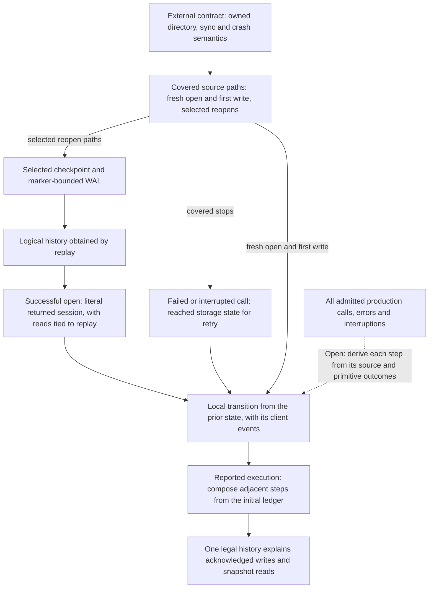

# Proof architecture

Alvoki's sequential Linux storage engine should implement a legal key-value history from the first open
through writes, maintenance, failures and later sessions. The current proofs establish that argument for
reported executions and connect selected routes to the literal returned table. The target is one
induction over the actual source schedules and their admitted primitive outcomes. Each step exports
the state it reaches, including failed opens and interruptions, so that later steps can compose
without a separate proof for each sequence. [Target execution argument](proofs/native-storage.md#target-execution-argument)

## The correctness argument in plain language

The intended guarantee is a single legal client history across writes, failures and later opens.
The argument connects five questions:

1. **Filesystem effects:** Which bytes and directory entries may survive the operations and a crash?
2. **Storage selection:** Which checkpoint and WAL prefix does a given surviving image select?
3. **Logical history:** Which ordered writes does replay of those selected bytes represent?
4. **Returned session:** Does the table returned by a successful open represent that replay?
5. **Client observations:** Does one history retain acknowledged batches and explain the snapshot reads already returned?

For example, in the [worked example](proofs/native-storage.md#worked-example), a second batch
is interrupted after an earlier batch was acknowledged. An admitted crash image can select the
earlier history or include the whole interrupted batch. The example follows a particular covered stop
through a successful reopen and its lookup. The general source-to-history argument is not yet
complete: existing results are conditional on the stated filesystem effects, observations and
coverage of the path being composed. The tables and diagrams below distinguish those results
from the remaining obligation.

## Three views of the engine

| View | Question it answers | Start here |
|---|---|---|
| Software architecture | How do the table, WAL, checkpoint, locks and recovery schedule operate? | [Sequential storage](architecture.md#sequential-storage) |
| Specification architecture | What counts as a legal client history, a valid snapshot or an allowed crash and retry? | [Client and format behavior](specifications.md) · [Native contract and public claims](proofs/native-storage.md#current-system-guarantees) |
| Proof architecture | Which refinements compose those guarantees, which executable paths supply the premises, and which obligations remain? | [Proof boundaries](proofs/native-storage.md#refinement-boundaries) · [Active proof roadmap](proof-roadmap.md#completion-checklist-for-native-key-value-refinement) |

## System claims

These names identify semantic claims across theorem or module changes. The linked native assessment
separates kernel evidence, executable coverage, premises and remaining obligations at the reviewed revision.

| Claim | Public guarantee | Semantic dependencies |
|---|---|---|
| [Client history](proofs/native-storage.md#client-history) | Every acknowledged write survives in order. Recovered mutations come from submissions in legal order, with each uncertain batch retained whole or omitted. | Valid initialization, durable WAL prefix, checkpoint selection, recovery, exact transition and ledger composition |
| [Snapshot reads](proofs/native-storage.md#snapshot-reads) | Supported point and ordered range reads on the returned session agree with replay. The guard explains denied handles and every recorded result remains tied to its original snapshot. | Client history, version visibility and retention, actual returned phase, pin issuance and ownership |
| [Checkpoint publication](proofs/native-storage.md#checkpoint-publication) | Each allowed crash selection identifies the exact immutable runs and replay watermark of a valid checkpoint. Publication preserves the client history. | Prepared checkpoint equivalence, ordered publication effects, durable bindings and correlated crash maps |
| [Recovery and retry](proofs/native-storage.md#recovery-and-retry) | A successful open uses the files selected by its admitted state and installs their exact replay and fresh references. Errors and interruptions establish the reached state consumed by retries. | Admission and ownership, checkpoint selection, ordered WAL reads, repair, cleanup and installation |
| [Reclamation](proofs/native-storage.md#reclamation) | Deletion preserves files needed by active and admissible recovery states, and the retained logical reads. | Durable selection, run and WAL eligibility, ownership and reference lifetime |
| [Progress and bounds](proofs/native-storage.md#progress-and-bounds) | Healthy recovery and scheduled eligible collection make progress under stated conditions. Work and space claims name what they count. | Recovery and reclamation safety, availability of required operations and resources, scheduling and allocation conditions |

## How the argument composes

The arrows show what each layer must supply. The solid paths describe existing conditional composition and selected source proofs. The dotted path is the remaining general production refinement.

Checkpoint and recovery proofs supply the selected files and their replay at the local step. Reclamation also needs eligibility of deleted files. Progress and bounds require availability, scheduling and a stated work measure. The six claims above link to those obligations.

Start with the [invariant map](proofs/native-storage.md#refinement-boundaries).
It follows one crash and reopen from file bindings to client history, identifies
who establishes and consumes each invariant, and marks the unproven steps.
A new error normally adds one local obligation at one of those boundaries.
Update the map when the argument or its assumptions change. Record individual
cases in the [roadmap](proof-roadmap.md#completion-checklist-for-native-key-value-refinement).

## How to navigate the evidence

The claims above record **semantic dependencies**, including requirements that are still open. Actual
**Lean dependencies** come from the elaborated declarations. **Executable coverage** is the path
and outcomes a theorem relates to an executable entry point. Review all three. A kernel dependency
edge establishes neither sufficient operational admission nor the adequacy of its statement.
The native assessment records proof, composition, executable coverage, remaining premises and
runtime evidence separately. [Evidence and checks](proofs/native-storage.md#evidence-and-checks)

Use the [proof index](proof-index.md) for transferable techniques and proof implementation guidance.
Use the [verification status](verification-status.md) for the checked subsystem and experiment inventory.
The [active checklist](proof-roadmap.md#completion-checklist-for-native-key-value-refinement) owns work
priorities and completion state. The detailed roadmap contracts and milestone notes remain references.
The [current handoff](progress.md) identifies the next missing premise and the last verified baseline.
Update the invariant map when consolidation changes the argument. Git history preserves earlier deliveries.

## Design and review a proof task

Before assigning substantial work, identify its parent claim, the missing obligation, the executable
path and the consuming theorem. Name the concrete and abstract state at the boundary, the allowed
external assumptions and the internal facts to derive. Write down how to verify that the new theorem
closes the obligation. When making a shared boundary, check it on materially different consumers and
try a case that challenges the invariant. A new layer earns its place by discharging an internal
premise, extending justified coverage or eliminating duplicated reasoning. [Proof-engineering guidance](proof-index.md#how-to-structure-a-proof)

When a signature grows, read it from the consumer's side. Which premise is
produced by an earlier step? Which paths or references does the next step
actually inspect? Discharge the first at its producer and scope the second
to that footprint. Keep filesystem facts about names, inodes and effects
independent of protocol facts about manifests, WAL cutoffs and acknowledgments.
After migrating consumers, remove any older proof that supplies only the
same guarantee. Preserve stronger guarantees that still have a caller.

Review specification and proof separately. Try a client-visible counterexample against the formal
statement, then check which premise or derived invariant rules it out. Check that the relevant
production path supplies the evidence at the actual reached state. For a difficult proof, first
examine the invariant, theorem statement and induction principle. Keep logical history and other
proof data outside runtime work. [Adversarial checks](proofs/native-storage.md#specification-review) · [Performance requirements](proof-roadmap.md#performance-requirements-for-verified-paths)
