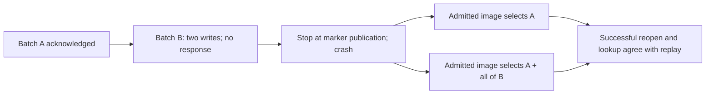

# Native storage correctness argument

This note follows the stock Lean sequential Linux `DiskTable` with a segmented WAL,
v2 manifest and v3 runs. It explains how filesystem facts reach the client-visible proof.
The [active checklist](../proof-roadmap.md#completion-checklist-for-native-key-value-refinement)
tracks missing production paths. See the [storage design](../architecture.md#sequential-storage)
for the executable protocol.

## Worked example

Imagine batch A has been acknowledged. A following batch B contains two writes, but the
process stops before the caller receives its result. After a crash, an allowed storage image
may lead recovery to A alone or to A followed by all of B. A partial B would violate the
batch-history contract. On the covered path below, a successful reopen returns a table whose
latest lookup agrees with the history selected by that image.



This is one verified route, not a claim that every possible interruption is already connected
end to end. It relies on the modeled file and directory effects, one allowed joint crash image,
observed successful open and the stated phase and token behavior. A sync or rename error may
have taken effect; the proof uses the observed effects rather than inferring them from the error.
The [premise provenance](#premise-provenance) and [recovery assessment](#recovery-and-retry)
make those assumptions and coverage explicit.

### Evidence for this route

In the covered execution, a fresh table acknowledges one row in A and B adds two rows.
The stop is at the final directory fsync while publishing the WAL marker:

1. The first acknowledgement gives the original sequence, ready phase and stored WAL. Given
   the observed name frames and a horizon covering both batches, it supplies the bounded WAL
   window to the next call on that same handle. [First acknowledgement with a WAL window][fresh-trace]
2. `RawSyncCalls.reachesRootFsyncStop` derives the successful append, staging, file-sync group,
   rename and cache read from the literal public write-stop. The cache read gives the issued
   fsync handle. The file effects and the sampled reboot map give the surviving marker and
   keeper on one physical selection. The recovered history is the first row or all three rows.
   No response is added for the second batch. The ledger records one uncertain submission.
   [Source stop and sampled selection][write-stop]
3. `Returned.readsAfterInterruptedSecondBatch` connects that selected history to a successful
   marked open on the sampled files. Its latest lookup uses the returned table's phase and token,
   at sequence 1 or 3 according to the chosen replay. A key first written by the second batch is
   visible only in the three-row history. The theorem uses the local file and reference effects,
   one reboot sample, and the observed successful open. [Fresh two-write proof][fresh-trace] · [Literal lookup and replay][authority]

## Refinement boundaries

Read the table from top to bottom. At each handoff, the output describes the same reached heap,
physical objects and logical state that the next proof uses.

| Handoff | Invariant | Producer → consumer |
|---|---|---|
| Reached file effects | Protected paths retain their live bindings and allowed bytes. Each later joint crash map has an earlier witness for the entire protected footprint. A file sync establishes durability for the inode on the issued descriptor. A directory sync establishes child-name durability. | Primitive effects compose through `CheckpointStorageObservation.Frames`. Reboot and retry use that frame to preserve the files needed for replay. [File frame][frame] · [Reboot and retry][reboot] |
| Selected storage under the lock | Admission ties the held lock and cached directory to the captured objects. One sampled map gives the manifest, its exact ordered run bytes and the marker-selected WAL. `WalSegmentImage.NamespaceWindow` preserves which canonical WAL names exist and which are absent in the bounded interval. | `RawWriteRebootEntry.selectsSampledRetry` produces the selected WAL entry. `SelectedIntegrityCheckpoint` and the held bounded reader supply the checkpoint replay inputs. [Authority][authority] · [WAL window](../../lean/Alvoki/Storage/Disk/Proofs/Write/NativeRawUncertainWrite.lean#L18) · [WAL selection][selection] · [Checkpoint selection][checkpoint-selection] |
| Installed session | The table returned by this open uses the phase, token, lock and cache from this admission and repair. The active WAL bytes and directory handle agree with storage at the returned heap. | The literal repair and installer produce this opened position. `NativeOpenedPosition.WriteStorageEntry` is the entry for writes on that table. Snapshot acquisition uses its actual phase and token. [Literal reader and installer][authority] · [Write entry][write-entry] · [Snapshot controls][pins] |
| Client history | A step extends the incoming history, submissions and reads with its own events. One replay explains the installed table and every recorded response. | `NativeExecutionStep.ledgerSuffix` feeds `NativeExecutionTrace.ledgerSuffix` and `keyValueRefinement`. Terminal prefixes use their own reached-state refinement when there is no ready table. [Installed replay][replay] · [Finite trace][trace] · [Terminal prefix][prefix] |

A frame states which facts a step preserves and on which paths. Its scope must include the
absence of a canonical WAL name if a later reader relies on that absence. Two individually
valid samples do not justify choosing a manifest from one and its runs from the other.
[Checked WAL extent scan][extents] · [Joint checkpoint selection][checkpoint-cut]

## Current system guarantees

### Client history

`FreshBootstrapOpenHeap.opensFromAdmission` derives the exact fresh public return from
admission and bootstrap effects. The empty state has a zero marker, empty keeper and no manifest.
With the reported allocation frames, the first acknowledgement supplies the same opened position
with updated WAL, sequence and ledger. For a supplied finite native trace, `Returned.refinesTrace`
derives the resulting history. Every acknowledged group is retained in order. An uncertain group
can be omitted or retained whole, and no recovered mutation can be invented. The terminal prefix
proof can explain prior reads even when the final operation never responded. Retrying a
request with a durable client identity needs its own contract.
[Fresh public return][fresh-open] · [First acknowledgement and trace][fresh-trace] · [Batch retention][batches] · [Terminal prefix][prefix]

### Snapshot reads

The packed table refines the logical point lookup and ordered half-open range read. The opened
proof adds the actual phase guard, session token, issued pin and response. Accepted point reads
distinguish an absent or deleted key from an API error. Recorded responses keep their original
snapshot sequence even after retention advances the floor. Covered foreign and inactive handle
routes reach the phase or ownership denial using their reported runtime comparisons.
[Table refinement][table] · [Client replay][replay] · [Snapshot controls][pins] · [Handle denials][foreign-pins]

### Checkpoint publication

A prepared checkpoint represents a committed prefix. The run writes and syncs establish candidate
immutable bytes while retaining the old manifest selection. After an effective manifest rename,
a crash can select the old manifest or the synced replacement before the final directory
barrier. An effective final barrier settles the replacement. In each choice the selected
generation and stamps determine the exact run bytes, and the watermark determines where WAL
replay begins. This preserves the acknowledged history. The source proofs cover specified reached
cuts, with filesystem effects for the issued descriptors.
[Publication model][checkpoint-model] · [Final barrier][checkpoint-cut] · [Source stop and recovery][source-stop]

### Recovery and retry

`DiskTable.open_fileTargets` exposes the actual admission, marker dispatch, replay, repair
and installation schedule. Reported read-only failures preserve selected files at their public
cleanup heap. A mutating failure can change the live keeper or later WAL names, so the next
attempt starts from that changed state. It can still retain multiple joint crash alternatives.
The same marked interpreter supplies the reached worker and cleanup across supported retries.
For an aligned keeper with no later WAL names,
`MarkedWalExtentReports.returnsAlignedMarkedInterpreter` uses measured reads, reached syncs
and actual allocations to derive public success. The same proof yields a latest lookup with
the stated phase and token effects.
[Production schedule][production] · [Measured aligned return][marked-open] · [Repair failures and retries][repair]

### Reclamation

Under the selected checkpoint and held lock, obsolete-run and covered-WAL eligibility preserve
the required recovery inputs and retained reads. The named-removal theorem accounts for the
first completed eligible obsolete-run collection under its scheduling and hold conditions.
Reclaiming physical storage additionally requires the last reference to be released and the
filesystem to return the allocation. Full native retry coverage and eventual collection remain
roadmap obligations.
[Run eligibility][run-gc] · [WAL deletion][wal-gc] · [Scheduled name removal][scheduled-gc]

### Progress and bounds

`CachedRetryInstalled.completesAfterCrashAndRetries` establishes equivalent reinstall after
an admitted crash and finite bounded attempts without writes, given fresh admission and healthy
primitive reports for the concluding attempt. The read, decoder and maintenance bounds count
specified callbacks, work or named payload under their own premises. Descriptor exhaustion,
allocated space and completion across every reachable failure are still open.
[Conditional recovery][progress] · [Selected read work][read-work] · [Named maintenance budget][budget] · [Detailed bounds](filesystem.md)

## Premise provenance

- **API scope.** Sequential table use in an engine-owned directory. The managed names are stable
  against external mutation, and other lock users cooperate. The directory's own binding is
  already durable in its parent. Syncing its children does not settle that parent binding.
- **Native and filesystem contract.** The Lean runtime, FFI, operating system and device supply
  truthful no-follow identity, extent and byte observations, complete enumeration through clean
  EOF, descriptor identity and lifetime, and the specified append, rename and sync effects.
  Process exit releases the references observed at exit. Power loss chooses one admitted
  joint crash map. A complete reference census matters when aliases can retain the lock.
  [Checked enumeration](../../lean/native/read_dir_checked.c) · [Filesystem contract](filesystem.md)
- **Effect versus response.** A failed fsync or rename may have taken effect. Before the final
  barrier, a live replacement of the keeper does not establish that the replacement survives.
  An allowed map contains the prior bindings or applies the same-directory rename as a whole,
  including removal of `WAL.next` when its synced inode becomes the keeper. Cleanup can
  replace an outward error if unlock also fails. [Keeper rename][rename] · [Retry and cleanup][repair]
- **Lifetime and availability.** File sync and the later release of its exact descriptor have
  separate guarantees. The adapter propagates explicit write and flush errors. A failure
  reported only at close is outside that observation. The pinned Lean runtime can leave a raw
  descriptor live after a failed `fdopen`; a create before that error can leave a name behind. Readable valid files, available
  resources and the necessary future I/O successes belong to progress. [Run custody][run-custody] · [Runtime limitations](filesystem.md)

Internal facts, such as a successful guard or a particular cache routing decision, come from
the reached source branch. Where a theorem still takes a local report, identify which earlier
step must produce it. The remaining central obligation is to derive the trace inputs for all
supported paths from the production callbacks and their admitted effects.
[Active checklist](../proof-roadmap.md#completion-checklist-for-native-key-value-refinement)

## Specification review

- **Partial uncertain batch.** The pilot Lean check admitted a one-row fragment of a two-row
  uncertain batch under a sublist-only rule. `DatabaseSubmissions.Retains` rejects that fragment.
  It also rejects replacing an acknowledged row with an unsubmitted row. Check that the
  public path actually produces the event to which the rule applies. [Batch retention][batches]
- **Inconsistent replay inputs.** If the checkpoint ends at 5 and the marker commits through 7,
  recovery requires frame 6 before frame 7. A valid frame 7 cannot fill a gap. A complete held
  listing and truthful absence observations matter: an omitted later segment would bypass
  pruning. An unlink failure after one of two removals can leave one later name absent and the
  other present. The next attempt must consume that reached image. [Ordinal checks][wal] · [Ordered repair][repair]
- **Wrong operation or object.** An ordinary EIO before the issued action and a stop on the later
  barrier using the same directory descriptor must not inhabit the earlier stop. Syncing a stale
  descriptor cannot make the replacement at its pathname durable. A lock alias may prevent a
  new open even after a drop. The new table's phase and token cannot authorize an old pin.
  [Stale descriptor][stale-fd] · [Admission and ownership][marked-open] · [Handle denials][foreign-pins]
- **Unsettled selection.** A failed open can observe a live marker that a subsequent reboot
  may lose. Keep the allowed alternatives until an effect settles them or a successful open
  exposes a recovered history. After that, later retries must preserve the settled ledger.
  A permanent selected-file read error may keep rejecting open. [Sampled retry][reboot] · [Conditional recovery][progress]

## Target execution argument

Prove that every finite execution of the supported sequential API from a fresh managed directory
has one legal client history under the admitted primitive and filesystem effects. Include prefixes
ending during an issued primitive or at a failed open. For every selected joint crash image, the
history must retain acknowledged groups in order, include only whole retained uncertain groups,
and explain the actual ready tables and snapshot responses.

1. Interpret the production schedule from its current state. Derive each ordinary return, error
   or issued stop and its reached state. Model process exit, power loss and each subsequent
   open as adjacent steps. An admitted execution must be defined independently of the
   existence of a high-level refinement report. [Source schedules][production]
2. Carry the physical bindings and custody, selected history and ledger through those steps.
   Install a ready-table relation only at the literal successful return. Derive the existing
   trace evidence from that chronology, reusing the current replay and read induction.
   [Invariant map](#refinement-boundaries) · [Finite trace][trace] · [Architecture](../proof-architecture.md)

## Checkpoint pilot

The early checkpoint pilot at `4a79765e` reused one selected-file installer for two stops.
The run-file stop consumes the pending run handle and keeps its issued descriptor live. The
first directory stop uses the original cached directory after the run slots are closed. Both
produce the literal returned table after the admitted reboot and aligned install.
`NativeOpenedSessionTrace.stopsCheckpointEarlyAndReadsLatest` uses that table and its issued pin
for the next point or range response. The separate manifest-rename error case established that
the shared installer also accepts either selected watermark. Later source work uses issued
prefix facts and protected-file frames through additional cuts and failed opens.
[Early checkpoint proof][pilot-early] · [Pilot read][pilot-read] · [Manifest rename][pilot-rename] · [Later source proof][source-stop]

## Why adding cases is expensive

The earlier trace architecture often bundled a stop, release or reboot, retries and successful
open into one constructor and report. The same cut could need a separate terminal report.
Shared local producer facts and exact reached endpoints let both consumers reuse the same
stop and let the retry proof handle the next open independently. Historical constructor counts,
detailed path notes and baseline revisions are recorded in the [archived assessment](https://github.com/alvoki/alvoki-lean/blob/d9adc1c9c1dde8b16b9490015a0b91e239cc8666/docs/proofs/native-storage.md).

## Research applied here

FSCQ separates crash conditions from ordinary returns. Argosy models each successive recovery
attempt at the state it actually reaches. IronSpec motivates testing which counterexamples the
specification itself admits, as with the partial batch above.
[FSCQ](https://dspace.mit.edu/entities/publication/0aa2b42b-3078-4bd5-93d3-4bc406534381) · [Argosy](https://doi.org/10.1145/3314221.3314585) · [IronSpec](https://www.usenix.org/conference/osdi24/presentation/goldweber)

## Migration test

Use the early run and directory fsync stops to test one reached-stop interface. Derive the
issued prefix once. End the execution at that stop, or extend the same prefix through a selected
reboot, a failed open, and the exact returned table of the next successful open. Check a read on
its issued pin. Then vary the selected manifest and the reached repair outcome independently.
Extend the same composition to an acknowledged batch followed by an uncertain one and reuse
the existing ledger proof. The [active checklist](../proof-roadmap.md#completion-checklist-for-native-key-value-refinement)
owns the current acceptance checks.

## Evidence and checks

The kernel and axiom audit check the Lean statements and proof dependencies. The sequential
fault suite checks actual Linux callbacks. Checkpoint fixtures exercise returned sync errors
and check the selected bytes and reads after reopen. Separate process-death fixtures interrupt
writes around native effects and check reopened reads and later writes. Old survivors after an
effective rename and other power-loss choices come from the formal filesystem contract.
[Checkpoint fault fixtures](../../lean/Alvoki/Checks/Tests/DiskTableChecks.lean) · [Process-death fixtures](../../scripts/check-disk-process-death.py) · [Sequential checks](../../scripts/check-sequential.sh) · [Reproduction](../../scripts/reproduce.sh)

With the pinned toolchain and trusted build artifacts, query the elaborated dependencies by name.

```sh
cd lean
lake build Alvoki.Storage.Disk.Proofs.Read.NativeOpenedSnapshotSessions
lake env lean --run Alvoki/Checks/Audit/ProofDependencies.lean \
  Alvoki.Storage.Disk.Proofs.Read.NativeOpenedSnapshotSessions \
  Alvoki.Storage.DiskSession.NativeOpenedSessionTrace.stopsCheckpointEarlyAndReadsLatest \
  Alvoki.Storage.DiskSession.NativeExecutionTrace.keyValueRefinement
```

The probe loads the module environment and its initializers. It reports direct references
in declaration types and available bodies, and transitive axioms. Check premise provenance
and production coverage against the source separately. [Dependency probe](../../lean/Alvoki/Checks/Audit/ProofDependencies.lean)

[frame]: ../../lean/Alvoki/Storage/Disk/Proofs/Checkpoint/NativeCheckpointFsyncEffects.lean#L18
[reboot]: ../../lean/Alvoki/Storage/Disk/Proofs/Write/NativeDurableWriteReboot.lean
[authority]: ../../lean/Alvoki/Storage/Disk/Proofs/Write/NativeAlignedWriteRecovery.lean
[selection]: ../../lean/Alvoki/Storage/Disk/Proofs/Write/NativeRawWriteReboot.lean#L224
[checkpoint-selection]: ../../lean/Alvoki/Storage/Disk/Proofs/WAL/WalSegmentRetryReads.lean#L122
[write-entry]: ../../lean/Alvoki/Storage/Disk/Proofs/Write/NativeReadyWriteStorage.lean#L74
[pins]: ../../lean/Alvoki/Storage/Disk/Proofs/Read/NativeOpenSnapshotControls.lean
[replay]: ../../lean/Alvoki/Storage/Disk/Proofs/Read/ClientReadTrace.lean
[trace]: ../../lean/Alvoki/Storage/Disk/Proofs/Native/Execution/NativeExecutionTrace.lean#L942
[prefix]: ../../lean/Alvoki/Storage/Disk/Proofs/Native/Execution/NativeExecutionPrefix.lean
[extents]: ../../lean/Alvoki/Storage/Disk/Proofs/Native/WAL/NativeMarkedWalExtentsHeap.lean
[checkpoint-cut]: ../../lean/Alvoki/Storage/Disk/Proofs/Checkpoint/CheckpointManifestDirectoryCut.lean
[fresh-open]: ../../lean/Alvoki/Storage/Disk/Proofs/Native/Open/NativeFreshTableOpen.lean
[fresh-trace]: ../../lean/Alvoki/Storage/Disk/Proofs/Native/Open/NativeFreshOpenedSessions.lean
[batches]: ../../lean/Alvoki/Storage/Disk/Proofs/Recovery/SegmentedBatchDatabaseTrace.lean
[table]: ../../lean/Alvoki/Storage/Table/PackedTable.lean
[foreign-pins]: ../../lean/Alvoki/Storage/Disk/Proofs/Read/NativeOpenExternalPinRead.lean
[checkpoint-model]: ../../lean/Alvoki/Storage/Proofs/Publication/CheckpointPublicationModel.lean
[source-stop]: ../../lean/Alvoki/Storage/Disk/Proofs/Native/Checkpoint/NativeFreshFinalCheckpoint.lean
[production]: ../../lean/Alvoki/Storage/Disk/DiskTable.lean
[marked-open]: ../../lean/Alvoki/Storage/Disk/Proofs/Native/Open/NativeMarkedOpenInterpreter.lean
[repair]: ../../lean/Alvoki/Storage/Disk/Proofs/Keeper/NativeLongKeeperFinalSyncObservation.lean
[run-gc]: ../../lean/Alvoki/Storage/Disk/Proofs/Collection/VersionedRunCollection.lean
[wal-gc]: ../../lean/Alvoki/Storage/Disk/Proofs/Collection/SegmentedCollectionStep.lean
[scheduled-gc]: ../../lean/Alvoki/Storage/Disk/Proofs/Native/Recovery/NativeScheduledRunReclamation.lean
[progress]: ../../lean/Alvoki/Storage/Disk/Proofs/Recovery/CachedRecoveryProgress.lean
[read-work]: ../../lean/Alvoki/Storage/Disk/Proofs/WAL/SelectedRecoveryChunkWork.lean
[budget]: ../../lean/Alvoki/Storage/Disk/Proofs/Session/NamedMaintenanceBudget.lean
[write-stop]: ../../lean/Alvoki/Storage/Disk/Proofs/Write/NativeRawWriteRootStop.lean
[rename]: ../../lean/Alvoki/Storage/Disk/Proofs/Keeper/NativeLongKeeperRenameError.lean
[run-custody]: ../../lean/Alvoki/Storage/Disk/Proofs/Checkpoint/NativeCheckpointRunDurability.lean
[wal]: ../../lean/Alvoki/Storage/Disk/WAL/WriteAheadLog.lean
[stale-fd]: ../../lean/Alvoki/Storage/Disk/Proofs/WAL/ReplacedWalDescriptor.lean
[pilot-early]: ../../lean/Alvoki/Storage/Disk/Proofs/Native/Checkpoint/NativeOpenedEarlyCheckpointReport.lean
[pilot-read]: ../../lean/Alvoki/Storage/Disk/Proofs/Read/NativeOpenedSnapshotSessions.lean
[pilot-rename]: ../../lean/Alvoki/Storage/Disk/Proofs/Checkpoint/NativeCheckpointManifestRenameTableOpen.lean
